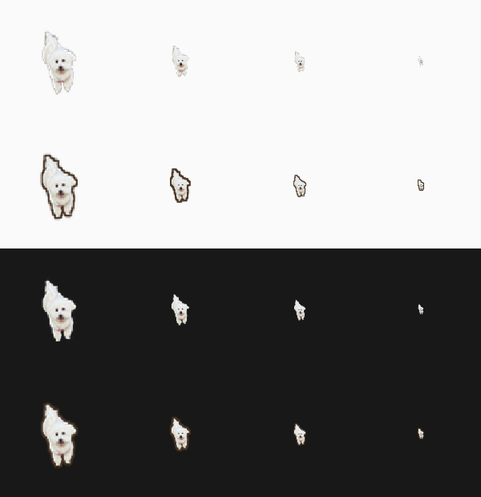

# 🐕 元宝桌宠 (YuanBaoPet)

像素风格桌面电子宠物狗 —— 一只叫"元宝"的白色小狗，永远悬浮在你的桌面上。

## ✨ 功能

- 🪟 **窗口置顶** — 悬浮在所有窗口之上
- 👻 **背景透明** — 只看到元宝本体
- 🖱️ **自由拖拽** — 左键拖到任意位置
- 💬 **对话气泡** — 点击说话、互动反馈、自言自语
- 🎬 **多帧动画** — 待机、走路、喝水、吃饭、洗澡、开心、睡觉
- 📊 **状态系统** — 饱食度/口渴度/清洁度/心情值随时间衰减
- 💾 **自动存档** — 退出自动保存，下次启动恢复
- 👋 **开机迎接** — 根据离开多久说不同的话（几小时 / 几天 / 很久没见）
- 🤗 **手感分级** — 轻点是摸摸、长按是抱抱、连点 5 下会生气
- 🕐 **时段与节日** — 早上/深夜/加班的台词不同，春节、中秋、圣诞、生日会换祝福和气泡颜色
- 🖥️ **多屏友好** — 自动识别多显示器，永远不会跑到屏幕外或任务栏下面
- 📌 **托盘图标** — 显示/隐藏、喂食、查看状态、开机自启、退出
- 🔒 **单实例** — 重复打开只会把已经在跑的那只叫到前面来

## 🎮 操作

| 操作 | 效果 |
|------|------|
| 左键拖拽 | 移动元宝 |
| 左键点击 | 摸摸元宝 → 对话气泡 |
| 长按（0.8 秒） | 把元宝抱起来 |
| 连续点击 5 下 | 元宝会生气并甩头 |
| 右键点击 | 菜单：喂食 / 喂水 / 洗澡 / 遛狗 / 状态 / 退出 |
| 托盘图标（单击/双击） | 显示并叫回元宝 |
| Alt+F4 | 元宝躲进托盘（不会退出） |

## 🚀 运行

```bash
# 方式一：双击 start_yuanbao.bat（会自动检查 Python，缺 PyQt5 时自动安装）
# 方式二：手动
pip install PyQt5
python main.py
```

## 📦 打包

```bash
# 双击 build_exe.bat：自动检查/安装 PyQt5 和 PyInstaller，然后打包
# 输出：dist\YuanBaoPet.exe，并自动复制一份到桌面
```

## 📁 项目结构

```
YuanBaoPet/
├── main.py                # 入口：单实例检查 + 托盘 + 启动
├── pet_window.py           # 透明置顶窗口 + 手势/迎接逻辑
├── pet_widget.py           # 精灵渲染 + 动画 + 抱起/甩头
├── bubble_widget.py        # 对话气泡（节日换色）
├── control_menu.py         # 右键菜单 + 状态面板
├── status_system.py        # 状态衰减系统
├── save_manager.py         # JSON存档 + 离开时长/纪念日
├── dialog_lines.py         # 200+条对话文本（含时段/节日/手势）
├── time_context.py         # 时段、节日、离开时长的判断
├── gestures.py             # 摸/抱/连点/拖拽 判定规则
├── screens.py              # 多显示器与任务栏避让
├── paths.py                # 开发/打包模式下的资源路径
├── tray.py                 # 系统托盘图标与菜单
├── autostart.py            # 开机自启（注册表 HKCU）
├── single_instance.py      # 单实例（重复打开叫回元宝）
├── generate_sprites_v3.py  # 精灵生成器（AI抠图+特效）
├── make_icon.py            # 生成多尺寸 yuanbao.ico（图标）
├── yuanbao.ico             # EXE / 托盘 / 窗口图标（16~256 七种尺寸）
├── sprites/                # 23帧像素精灵
├── build_exe.bat           # PyInstaller打包脚本
└── start_yuanbao.bat       # 双击启动
```

## 🖼️ 换图标

图标就是 `yuanbao.ico` 一个文件，EXE 内嵌图标、托盘图标、窗口图标都来自它：

```bash
# 1) 想自己换：准备好一个 .ico（建议含 16/32/48/256 多尺寸），覆盖 yuanbao.ico
# 2) 想用精灵图重新生成（三种风格）：
python make_icon.py                    # 透明背景（默认）
python make_icon.py --style outline    # 透明背景 + 深色描边，浅色任务栏也看得清
python make_icon.py --style tile       # 暖橙色圆角底
# 3) 重新打包
build_exe.bat
```

- 当前默认生成的是 `--style outline`：背景全透明，只给小狗描了一圈深色边，避免在白色资源管理器里糊成一片。
- 三种风格在浅色/深色背景下的对比（上：透明，下：透明+描边）：



- 打包脚本检测到 `yuanbao.ico` 会自动带上 `--icon`，并把它一起打进 EXE 供托盘加载。
- 只跑源码时（`python main.py`）托盘图标同样读这个文件，改完立刻生效、无需打包。
- 没有 `yuanbao.ico` 时会退回用精灵图当图标（功能不受影响）。

## 🧪 自测

```bash
python -m compileall .          # 语法检查
python main.py                  # 手动跑一遍：迎接 / 长按 / 连点 / 托盘
```

- 托盘菜单里勾选「开机自动启动」会把命令写进注册表 `HKCU\Software\Microsoft\Windows\CurrentVersion\Run`，取消勾选即删除。
- 想验证「欢迎回来」的不同台词，可以修改 `%APPDATA%\YuanBaoPet\save.json` 里的 `last_save_time`。

## 🎨 精灵生成

基于真实狗狗照片，使用 rembg (U2Net AI) 抠图，然后像素化并添加碗、水花、食物、泡泡、爱心等特效。
